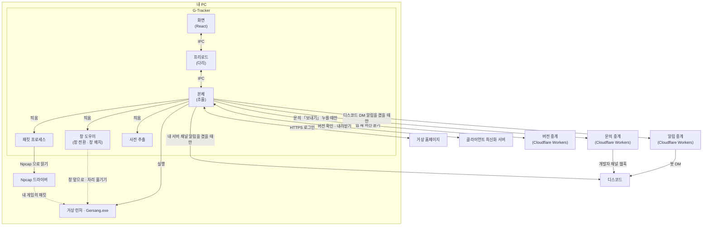
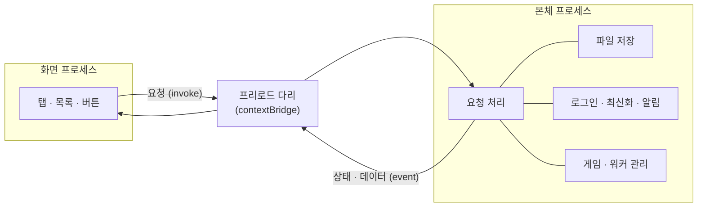
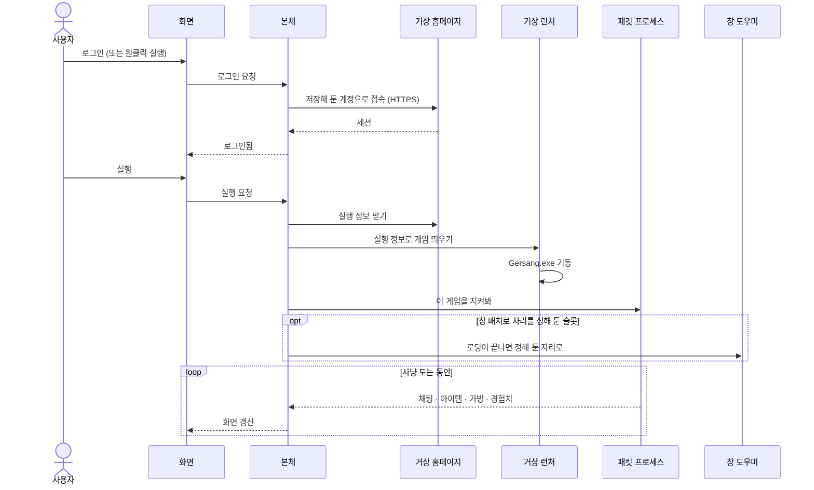
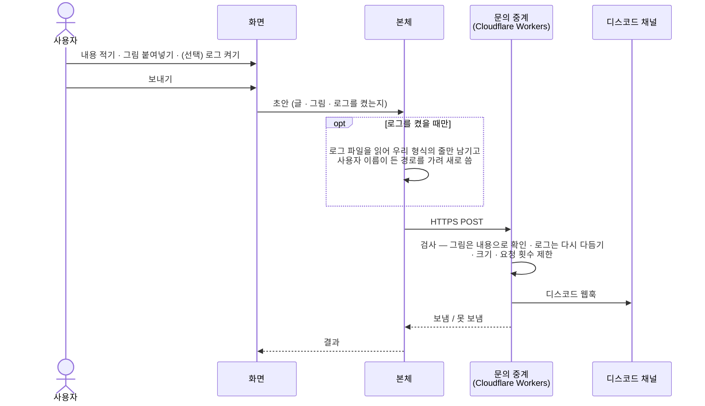
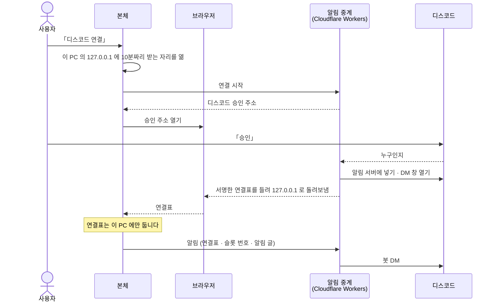

# G-Tracker 구조

> 이 도구가 어떻게 만들어졌는지, 왜 "내 PC 밖으로 함부로 안 나간다"가 약속이 아니라 구조인지
> 정리한 글입니다. 사용법은 [README](README.md) · [화면 안내](GUIDE.md) 를 보세요.

바깥에 서버를 두지 않은 데스크톱 앱 하나입니다. 로그인부터 게임 실행 · 창 배치, 트래킹까지 전부 이
PC 안의 프로세스들이 나눠 맡습니다. 앱이 바깥과 말을 섞는 곳은 정해져 있습니다 — 로그인할 때의
거상 홈페이지, 클라이언트를 최신으로 맞추는 서버, 새 버전 확인, 그리고 **사용자가 직접 누르거나 켰을 때만**
쓰는 문의 중계와 디스코드 알림입니다. 통계는 없고, 로그는 문의에서 사용자가 직접 켰을 때만 함께 갑니다.

---

## 한눈에 보기

화면·본체·보조 셋으로 프로세스가 갈립니다. 무거운 일을 화면과 같은 프로세스에 두지 않으려는
것이라, 캡처가 밀려도 화면이 끊기지 않고 그 반대도 마찬가지입니다.

| 프로세스 | 하는 일 |
|---|---|
| **본체** | 로그인·게임 실행·파일 저장·알림을 조율합니다. 나머지 프로세스를 띄우고 잇는 곳입니다 |
| **화면** | 탭과 목록을 그립니다. 데이터를 직접 만지지 않고 본체에 물어봅니다 |
| **패킷** | 내가 띄운 게임이 주고받는 것을 읽어 채팅·아이템·가방·경험치로 풀어 냅니다. 본체와 떨어져 돌아, 사냥이 바빠도 화면이 버팁니다 |
| **창 도우미** | 단축키로 게임 창을 앞으로 가져오고(창 전환), 정해 둔 자리로 게임 창을 옮깁니다(창 배치). 둘 다 안 쓰면 내려갑니다 |
| **사전 추출** | 아이템 이름·그림을 클라이언트에서 한 번 뽑아 둡니다 |

---

## 화면과 본체는 어떻게 말하나

화면 쪽 코드는 파일도, 네트워크도, 게임 프로세스도 **직접 만질 수 없습니다.** 할 수 있는
것은 정해진 통로 하나로 본체에 부탁하는 것뿐이고, 그 통로가 프리로드(다리)입니다. 메인 창과
오버레이 창은 보안 상자(샌드박스) 안에서 뜹니다 — 앱이 관리자 권한으로 돌아도, 화면 쪽에 문제가
생겼을 때 PC 의 다른 곳에 닿지 못하게 한 겹 더 막아 둡니다.

- **화면 → 본체**: "이 계정으로 로그인해", "이 슬롯 실행해" 같은 요청을 보냅니다.
- **본체 → 화면**: 로그인 상태, 새로 들어온 채팅·아이템·경험치를 밀어 줍니다.

통로를 하나로 좁혀 둔 덕에, 화면에서 무엇을 누르든 실제로 파일을 쓰거나 게임을 띄우는 일은
전부 본체 한 곳을 거칩니다. 화면은 결과를 그리기만 합니다.

패킷·창 도우미·사전 추출 프로세스는 본체가 띄우고, 본체하고만 메시지를 주고받습니다. 화면과
직접 이야기하지 않습니다.

---

## 로그인부터 트래킹까지

로그인은 저장해 둔 계정으로 홈페이지에 붙어 **세션만** 받아 오는 일입니다. 평소에는 창을
띄우지 않습니다 — 직접 확인이 필요한 때(로그인 불가)만 그 계정으로 사이트 창을 엽니다.
「원클릭 실행」은 이 로그인과 실행을 슬롯 차례대로 이어서 할 뿐, 하는 일은 같습니다.

실행은 홈페이지에서 받은 실행 정보를 거상 런처에 그대로 넘겨 게임을 띄웁니다. 그런 다음
패킷 프로세스에 "이 게임을 지켜봐" 라고 넘기면, 그때부터 오가는 것을 읽어 화면에 채웁니다.
**앱을 켜기 전에 지나간 것은 볼 수 없습니다.**

창 배치는 게임 창의 자리만 옮깁니다. 로딩 중에 옮기면 창이 깨지므로, 창이 멈추고 게임이 창
메시지에 바로 답할 때까지 기다린 뒤 옮깁니다. 게임에 무엇을 보내거나 게임 해상도를 바꾸지는 않습니다.

---

## 문의는 어떻게 가나

문의 탭에서 「보내기」를 누르면 본체가 **우리 문의 중계**로 보내고, 중계가 개발자의 디스코드
채널에 올립니다. 누르기 전에는 아무것도 나가지 않습니다.

- **왜 중계를 거치나.** 디스코드 웹훅 주소를 앱에 넣으면 누구나 앱에서 꺼내 그 채널에 글을
  쏘거나 웹훅을 지워 버릴 수 있습니다. 웹훅 주소는 중계(Cloudflare Workers)에만 비밀값으로
  두고, 앱은 중계 주소만 압니다. 중계는 멘션·사칭을 막고, 요청 횟수와 크기를 자릅니다.
- **함께 가는 것.** 적은 내용, 연락처(적었을 때만), 붙여넣은 그림, 환경 몇 줄(앱 버전 · OS ·
  창 크기 · 캡처 상태 · 네트워크 어댑터 상태 — IP 주소는 없음) — 환경은 보내기 전에 화면에 그대로 보여 줍니다.
- **로그는 켰을 때만.** 「로그 파일 함께 보내기」는 늘 꺼진 채 시작하고, 보내고 나면 다시 꺼집니다.
  켜면 몇 줄·몇 KB 가 가는지 옆에 적힙니다. 로그 파일을 그대로 보내지 않고 **우리 로그 형식의
  줄만 남겨 새로 쓰며**, 윈도 사용자 이름이 든 경로(`C:\Users\<이름>\…`)는 가립니다. 중계도
  같은 검사를 한 번 더 합니다.
- **사용자가 고를 수 있는 파일은 그림뿐입니다.** 그림도 중계가 내용(파일 앞머리)으로 확인해
  그림이 아니면 뺍니다.
- **안 가는 것.** 계정 비밀번호, 게임 설치 경로, 채팅 · 아이템 · 경험치 기록.

---

## 디스코드 알림은 어떻게 가나

접속 대기 끝 · 사통팔달 키워드 · 주막 임무 끝 알림은 기본으로 **이 PC 의 Windows 알림**으로 뜹니다.
설정 → 「알림」에서 받을 곳을 「디스코드」로 골랐을 때만 바깥으로 나가고, 방식은 둘입니다.

**DM 으로 받기** — 우리 알림 중계(Cloudflare Workers)와 디스코드 봇이 DM 을 보냅니다.

- **중계는 아무것도 적지 않습니다(DB 없음).** 누구에게 보낼지는 중계가 서명한 **연결표**에 박혀 있고,
  그 연결표는 앱이 듭니다. 앱은 받는 사람을 고를 수 없어, 연결표가 새도 그 사람에게만 DM 이 갑니다.
- **보내는 것은 슬롯 번호와 알림 글뿐입니다.** 로그인 아이디는 보내지 않고, 익명 모드면 캐릭터 이름도 뺍니다.
- G-Tracker-Notification 서버를 나가면 디스코드가 DM 을 막아, 알림은 다시 Windows 알림으로 돌아옵니다.

**내 서버 채널로 받기** — 중계를 거치지 않습니다. 사용자가 자기 디스코드 서버 채널에 만든 웹후크
주소로 **앱이 바로** 보냅니다. 주소는 디스코드 웹후크 꼴(`discord.com/api/webhooks/…`)만 받고,
비밀번호와 같은 방식으로 암호화해 이 PC 에만 둡니다.

---

## 새 버전 확인

앱은 우리 버전 중계(Cloudflare Workers)에 「지금 최신 버전이 몇인가」만 묻습니다. 중계는 공개 배포
저장소의 릴리즈를 보고 답합니다. 새 버전이 있으면 왼쪽 메뉴 맨 아래 「최신 버전 받기」에 표시만 하고,
받는 일은 브라우저로 사용자가 합니다 — 앱이 스스로 내려받거나 설치하지 않습니다.

---

## 트래킹은 읽기만 합니다

트래킹은 내가 띄운 거상 클라이언트가 주고받는 것을 **곁에서 읽는** 방식입니다(그래서
Npcap 이 필요합니다). 게임에 무언가를 보내거나, 메모리를 건드리거나, 파일을 고치는 일은
없습니다. 다른 프로그램의 트래픽도 잡지 않습니다 — 내가 띄운 게임의 것만 봅니다.
설정 → 「탭」에서 숨긴 탭에 쓰던 패킷은 잡혀도 읽지 않고 바로 버립니다.

---

## 무엇과 통신하나

| 상대 | 언제 | 무엇을 |
|---|---|---|
| **거상 홈페이지** | 로그인 · 실행 직전 | 저장한 계정으로 세션을 받고, 실행 정보를 받습니다 |
| **클라이언트 최신화 서버** | 실행 직전 · 클라이언트 받기 | 클라이언트가 최신인지 확인하고, 뒤처졌으면 받아 둡니다 |
| **버전 중계 (Cloudflare Workers)** | 앱을 켤 때 등 | 최신 앱 버전을 묻습니다. 보내는 것은 없습니다 |
| **문의 중계 (Cloudflare Workers)** | 문의 탭에서 「보내기」를 누를 때만 | 문의 내용 · 그림 · 환경 몇 줄, 켰을 때만 다듬은 로그. 중계가 디스코드 웹훅으로 개발자 채널에 올립니다 |
| **알림 중계 (Cloudflare Workers)** | 받을 곳을 「디스코드 · DM 으로 받기」로 골랐을 때만 | 연결할 때 디스코드 승인, 알림마다 연결표 · 슬롯 번호 · 알림 글 |
| **내 디스코드 웹후크** | 받을 곳을 「디스코드 · 내 서버 채널로 받기」로 골랐을 때만 | 알림마다 슬롯 번호 · 알림 글 |

이것 말고 바깥으로 나가는 요청은 없습니다.

---

## 어디에 무엇이 남나

| 무엇 | 어디에 | 앱을 끄면 |
|---|---|---|
| **비밀번호** | Windows 자격 증명(DPAPI)으로 암호화해 이 PC 에만 | 남습니다 (이 PC 에서만 풀립니다) |
| **디스코드 연결표 · 웹후크 주소** | 앱 데이터 폴더에. 웹후크 주소는 비밀번호와 같은 방식으로 암호화 | 남습니다 |
| **계정 · 클라이언트 · 창 배치 · 알림 설정** | 앱 데이터 폴더에 파일로 | 남습니다 |
| **주막 임무 시간 · 이벤트 체크** | 앱 데이터 폴더에 파일로 | 남습니다 (다음에 이어 보려고) |
| **육의전 시세 · 아이템마다 고른 시세** | 앱 데이터 폴더에 파일로 | 남습니다 |
| **채팅 · 아이템 · 경험치 · 가방 · 맡긴 용병 · 상단 명단과 기여도** | 메모리에만 | 사라집니다 |
| **로그** | 앱 데이터 폴더의 `logs` (배포본은 경고·오류만, 1MB 두 벌) | 남습니다. 사용자 이름이 든 경로는 가려서 씁니다 |
| **보낸 문의** | 개발자 디스코드 채널 | 보낸 뒤로는 그 채널에 남습니다 |
| **디스코드 알림** | 내 디스코드 DM 또는 내 서버 채널 | 보낸 뒤로는 디스코드에 남습니다 |

파일로 남는 것도 전부 이 PC 안입니다. 비밀번호 파일은 다른 컴퓨터로 옮겨도 풀리지
않습니다 — 자격 증명이 그 PC 에 묶여 있기 때문입니다.

---

## 무엇으로 만들었나

| | |
|---|---|
| **앱 틀** | Electron (본체는 Node, 화면은 Chromium) |
| **화면** | React + TypeScript |
| **패킷 읽기** | `dumpcap` (앱에 함께 담김) + 사용자가 설치하는 Npcap 드라이버 |
| **창 전환 · 창 배치** | Windows API (koffi) |
| **중계 셋(버전 · 문의 · 알림)** | Cloudflare Workers — 문의는 Discord 웹훅, 알림은 Discord 봇 |
| **대상** | Windows 10 / 11 (64비트) |
