<!--
  화면 안내 — README 의 「화면 안내」에서 잇는다. 탭(왼쪽 메뉴) 차례대로, 그다음 오버레이 · 설정.
  README 와 같은 원칙: 프로토콜 분석 결과(opcode · 패킷 구조)는 적지 않는다. 이미지는 `images/`.
  머리글은 링크 앵커로 쓰므로 바꾸면 README 의 링크도 함께 고친다.
-->

# G-Tracker 화면 안내

[← README 로](README.md)

왼쪽 메뉴 차례대로 적었습니다. 안 쓰는 탭은 [설정](#설정) → 「탭」에서 숨길 수 있습니다.

- [클라이언트](#클라이언트) — 로그인 · 실행 · 원클릭 실행 · 접속 대기 · 창 배치
- [채팅](#채팅) · [수익 트래킹](#수익-트래킹) · [가방](#가방) · [육의전](#육의전)
- [EXP](#exp) — 부대원 · 장비 · 전투 외 경험치 · 정령 친밀도 · 신용도
- [주막](#주막) · [거상 이벤트](#거상-이벤트) · [상단](#상단) · [상자 열기 · 문의](#상자-열기--문의)
- [오버레이](#오버레이) · [설정](#설정)

---

## 클라이언트

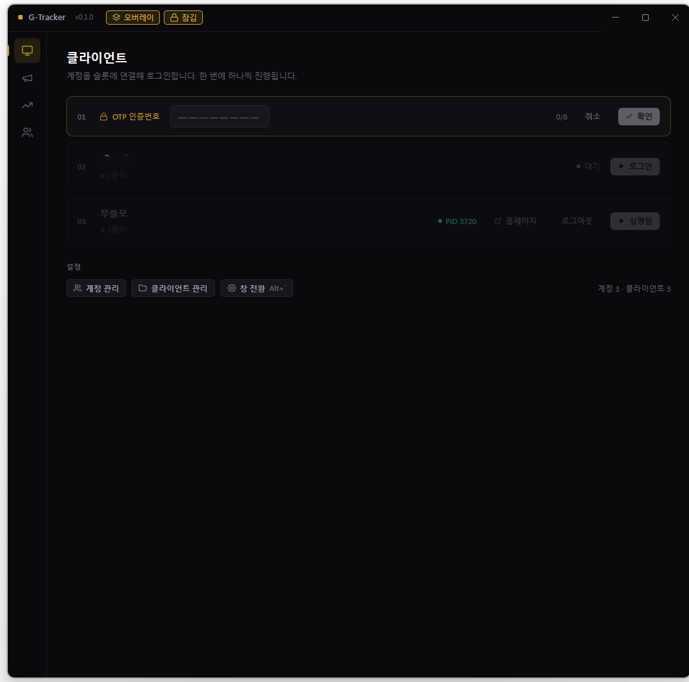

슬롯마다 계정과 클라이언트를 고릅니다. 로그인이 끝나면 **실행** 버튼이 뜨고, 그 옆의
**홈페이지** 버튼은 그 계정으로 거상 사이트를 엽니다(창을 닫아도 로그인은 유지됩니다).

OTP 를 쓰는 계정은 그 줄이 인증번호 입력 칸으로 바뀝니다. 틀리면 칸이 비워지고
5초 뒤에 다시 칠 수 있습니다.

아래 버튼으로 여는 창들:

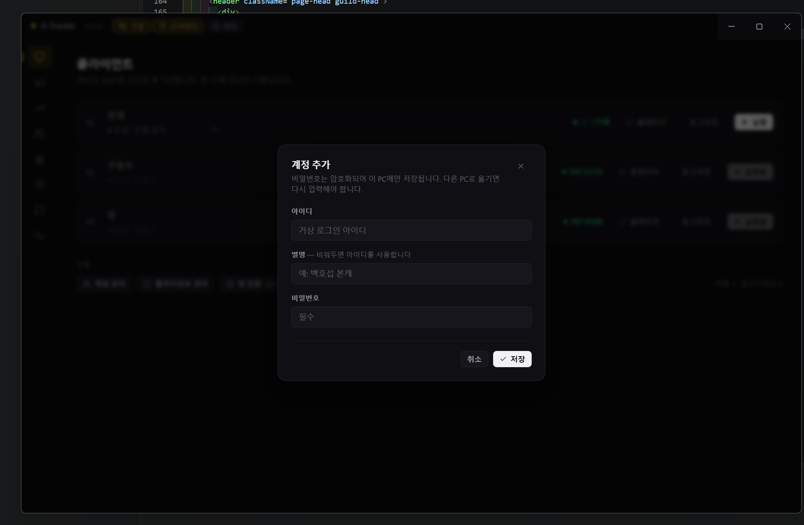

**계정 관리** — 거상 아이디·비밀번호를 등록합니다. 비밀번호는 이 PC 에만 암호화해 둡니다.

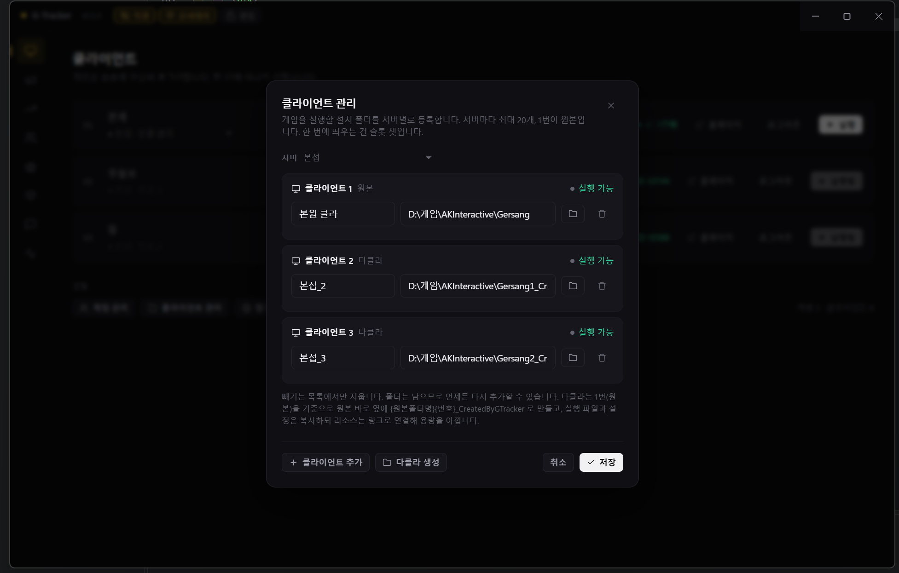

**클라이언트 관리** — 거상을 설치한 폴더를 원본으로 지정하고, 다클라 폴더를 만듭니다.

### 원클릭 실행

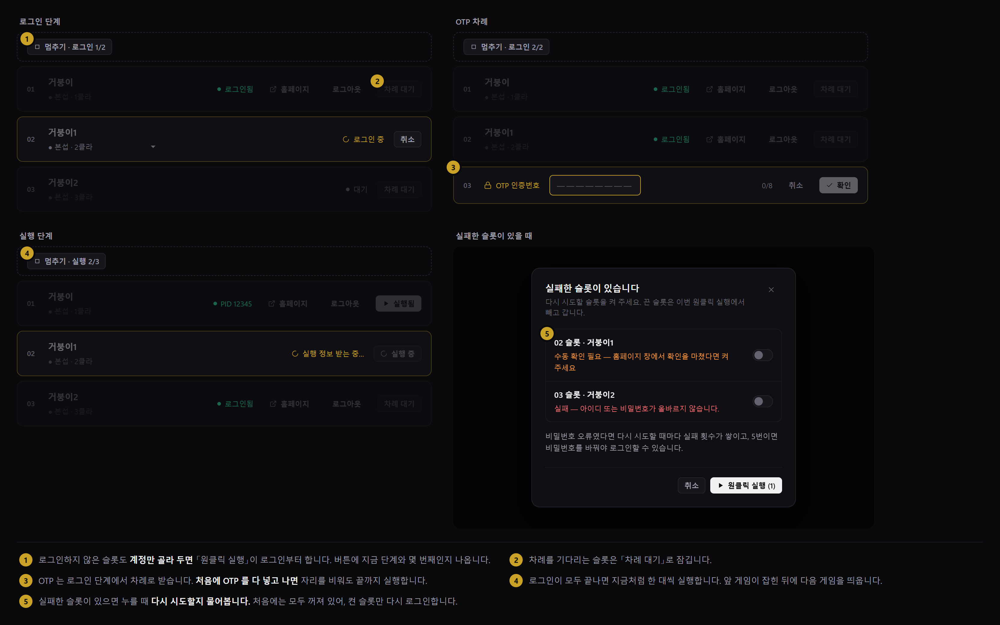

슬롯에 계정만 골라 두고 **원클릭 실행** 을 누르면, 로그인 → (OTP) → 게임 실행을 슬롯 차례대로
이어서 합니다. 이미 로그인한 슬롯은 바로 실행합니다.

- 로그인을 먼저 모두 끝낸 뒤 게임을 한 대씩 띄웁니다. OTP 계정이면 처음에 넣어 주세요 — 다 넣고 나면
  자리를 비워도 끝까지 실행합니다. 5분 안에 넣지 않으면 그 슬롯만 빼고 이어 갑니다.
- 버튼에 지금 단계와 몇 번째인지(「멈추기 · 로그인 1/2」) 나오고, 「멈추기」를 누르면 지금 슬롯까지만 하고 멈춥니다.
- 직전에 실패한 슬롯이 있으면 다시 시도할지 물어봅니다. 비밀번호 오류는 시도할 때마다 실패 횟수가
  쌓이니 사유를 보고 켜 주세요.

### 접속 대기

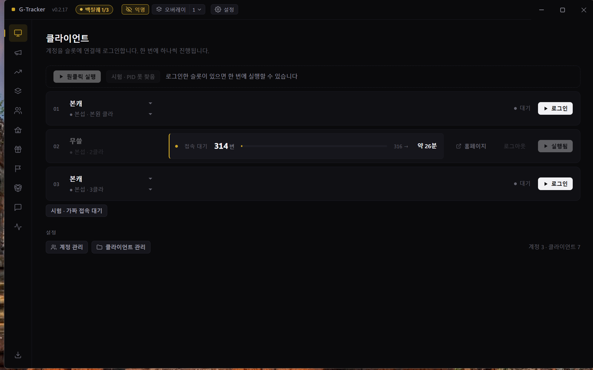

점검 직후처럼 서버 선택 뒤 대기 순번이 뜨면, 그 슬롯 줄에 「접속 대기 210번」과 진행 막대,
남은 시간이 뜹니다. 대기가 끝나면 알림으로 알려 드립니다([설정](#설정) → 「알림」).
대기 중에는 그 슬롯의 「로그아웃」이 잠깁니다 — 대기를 그만두려면 게임 창을 닫아 주세요.

### 게임 창 배치

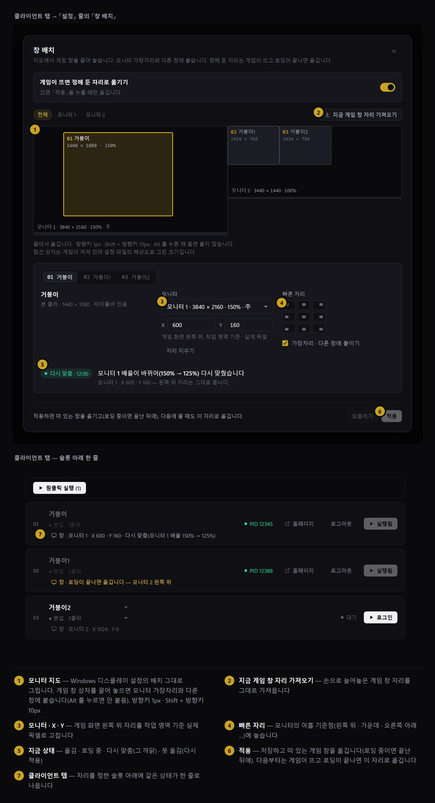

클라이언트 탭 「설정」 줄의 **창 배치** 에서 슬롯마다 게임 창 자리를 정해 두면, 게임이 뜨고
로딩이 끝난 뒤 그 자리로 옮깁니다.

- 모니터 지도(Windows 디스플레이 설정의 배치 그대로)에서 게임 창 상자를 끌어 놓습니다. 모니터 가장자리와
  다른 게임 창에 붙습니다(Alt 를 누르면 안 붙음). 모니터 · X · Y · 빠른 자리(아홉 기준점)로 정확히 고칠
  수도 있고, **지금 게임 창 자리 가져오기** 로 손으로 늘어놓은 자리를 그대로 가져올 수도 있습니다.
- **적용** 을 누르면 저장하고 떠 있는 게임 창을 옮깁니다(로딩 중이면 끝난 뒤에).
- 게임 안에서 타이틀바를 켜고 끄거나 해상도를 바꾸거나, Windows 의 모니터 배율 · 연결이 바뀌면 같은 자리로
  다시 맞추고 그 까닭을 보여 줍니다. 손으로 옮긴 창은 바로 되돌리지 않고, 다음에 이런 일이 생기거나 게임을
  다시 켤 때 정해 둔 자리로 갑니다.
- 게임 해상도는 바꾸지 않습니다. 전체 화면이면 창 모드로 돌아올 때까지 기다립니다.
- 자리를 정한 슬롯은 클라이언트 탭 슬롯 아래에 지금 상태가 한 줄로 나옵니다(옮김 · 로딩 중 · 다시 맞춤 ·
  못 옮김). 자동으로 옮기는 것을 끄려면 「게임이 뜨면 정해 둔 자리로 옮기기」를 끄세요 — 그때는 「적용」을
  누를 때만 옮깁니다.

---

## 채팅

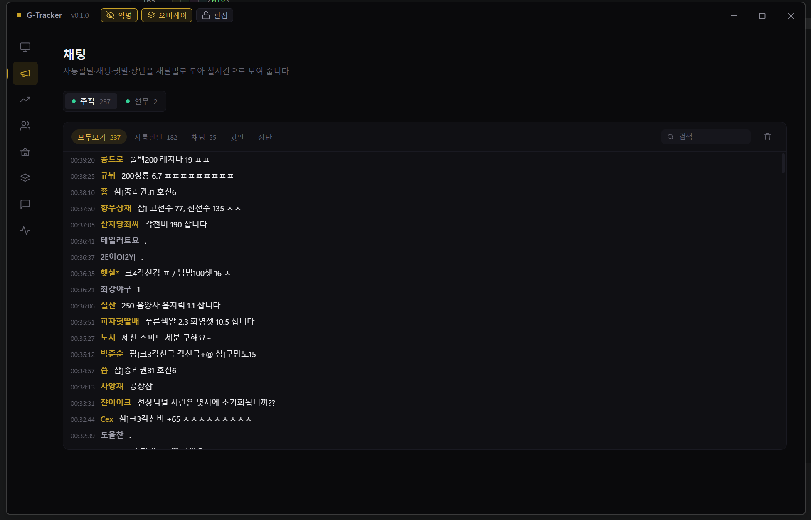

전체 채팅을 계정별로 모아 봅니다. 내가 보낸 줄은 밝게 표시됩니다. 🔔 에 사통팔달 키워드를 넣어 두면
그 말이 나온 줄을 금색으로 강조하고 알려 드립니다.

---

## 수익 트래킹

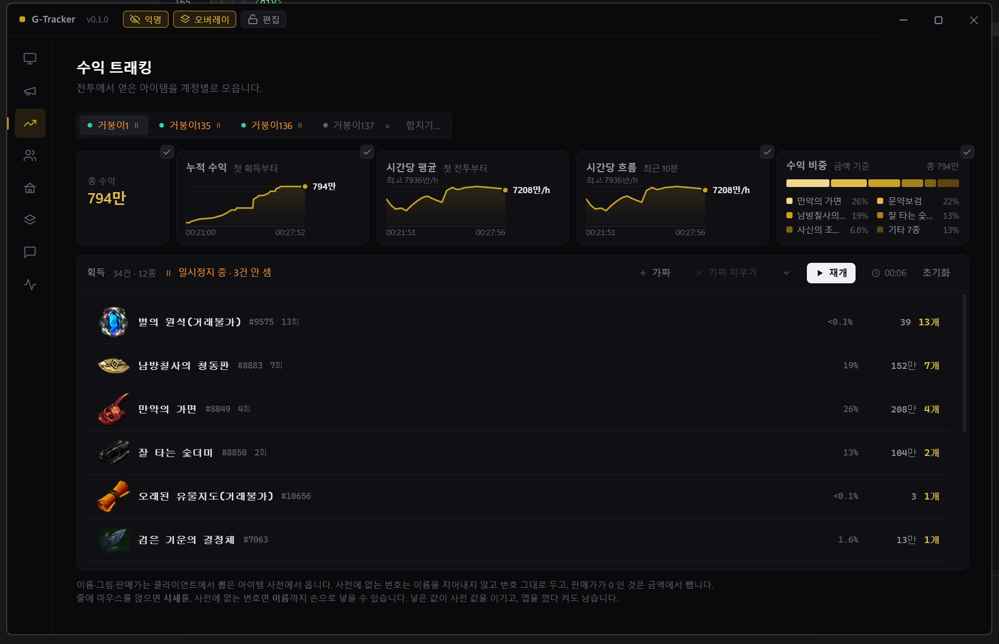

사냥에서 얻은 아이템을 종류별로 셉니다. 이름과 그림은 클라이언트에서 뽑은 사전에서
가져옵니다. 사전에 없는 번호는 이름을 지어내지 않고 번호 그대로 둡니다.

파티원이 먹은 것과, 누구 것인지 가리지 못한 것은 목록에 넣지 않고 **건수만** 따로 보여
줍니다.

### 시세

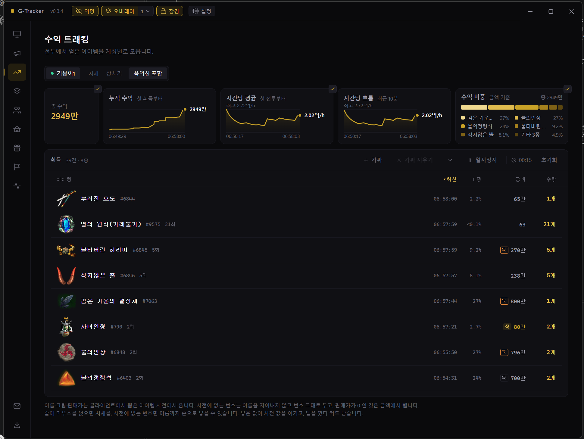

탭 위쪽 **시세** 에서 금액을 무엇으로 셀지 고릅니다. 기본은 **상재가** 이고, **육의전 포함** 이면 상재가와
[육의전](#육의전) 최저가 중 비싼 쪽으로 셉니다. 목록 금액 앞의 「육」은 육의전 최저가, 「직」은 직접
넣은 값입니다. 오버레이의 수익 금액도 같은 기준입니다.

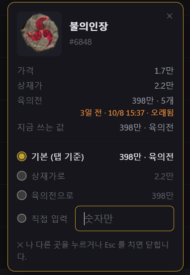

아이템 줄을 누르면 그 아이템만 따로 고르는 카드가 뜹니다 — **기본(탭 기준) · 상재가로 · 육의전으로 ·
직접 입력**. 고른 것은 앱을 다시 켜도 남고 모든 계정에 함께 적용됩니다. 본 지 하루가 지난 육의전 값에는
「하루 넘음」이 붙습니다.

### 자리 합치기

앱을 켜기 전부터 게임이 떠 있었다면 그 자리는 아이디 대신 `PID 12345` 로 잡힐 수 있습니다.
같은 클라가 두 자리로 갈렸을 때는 `합치기` 로 한 자리에서 모아 볼 수 있습니다.
`분리` 를 누르면 각자에게 그대로 돌아갑니다.

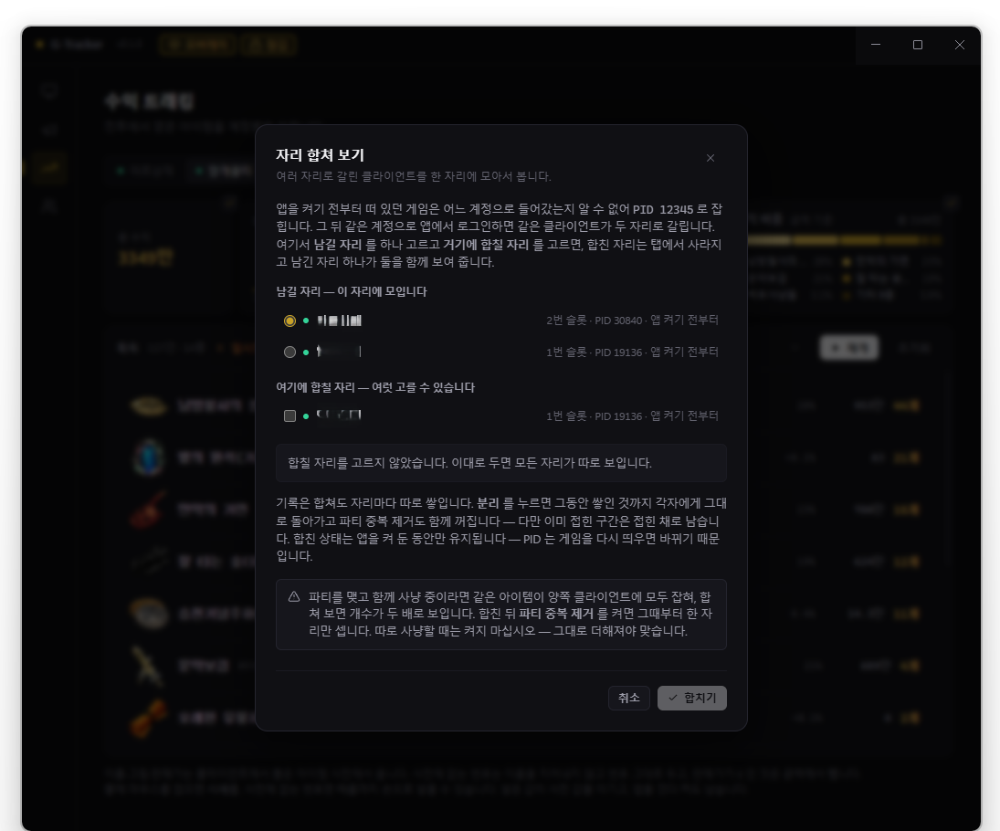

---

## 가방

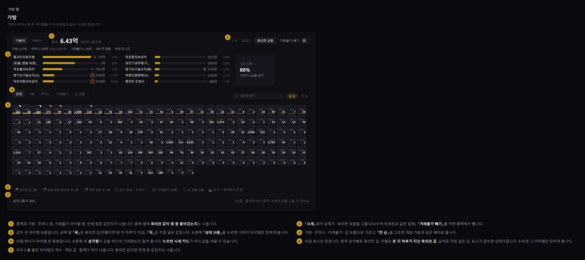

캐릭터의 가방과 주머니에 든 아이템이 지금 얼마어치인지 봅니다. 값은 수익 트래킹과 같은 시세로 매깁니다.

- 위쪽에 총액과 가방 · 주머니 몫, 거래불가 아이템 몫, 언제 맞춘 값인지가 나옵니다.
- 막대는 값이 큰 아이템 10종을 보여 주고, 아래 칸에는 모든 아이템이 나옵니다. 마우스를 올리면 개수 ·
  개당 값 · 합계가, 누르면 시세 카드가 떠서 값을 바꿀 수 있습니다.
- 아이템 칸 오른쪽 위 삼각형으로 값을 어디서 가져왔는지 보입니다 — 흰색은 육의전 최저가, 속이 빈 주황색은
  하루 지난 육의전 최저가, 금색은 직접 넣은 값, 표시가 없으면 상재가.
- 「칸 순」을 고르면 게임 가방과 같은 배치로 보고, 「거래불가 빼기」를 켜면 거래불가 · 귀속 아이템을 총액에서 뺍니다.

가방은 저장하지 않습니다. 캐릭터를 골라 게임에 들어가면 채워지고, 주머니는 게임에서 가방 창의 주머니 탭을
한 번 누르면 더해집니다.

---

## 육의전

게임에서 육의전을 열면 그때 보인 매물이 **서버별로** 여기에 쌓입니다. 외부 사이트에서 값을 받아오지 않고,
**각 게임 클라이언트가 육의전에서 받은 데이터** 로만 계산합니다.

- 값은 「지금 시세」가 아니라 「내가 본 것 중 최저」입니다. 팔렸는지는 앱이 알 수 없으니, 시세 카드에서
  수량과 본 때를 함께 확인하세요.
- 수익 트래킹 · 가방은 지금 그 클라가 붙어 있는 서버의 값을 씁니다. 게임을 꺼도 마지막으로 접속했던 서버의
  값으로 셉니다.

---

## EXP

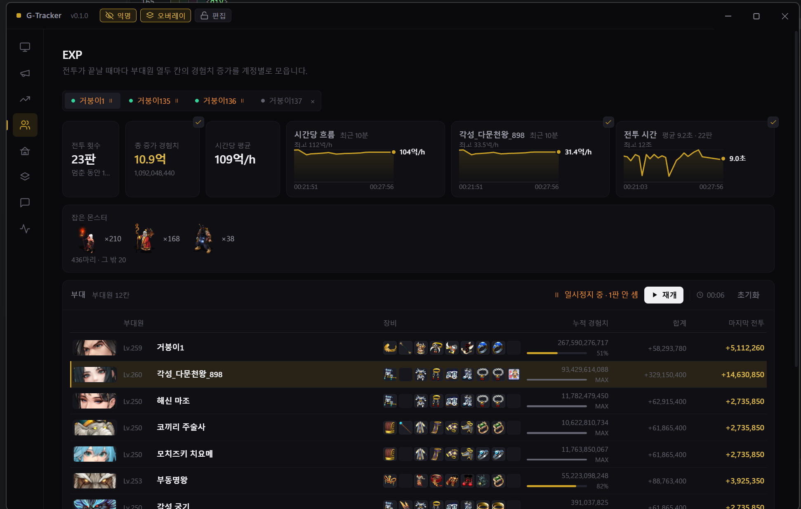

전투가 끝날 때마다 부대원 열두 칸의 경험치를 모읍니다.

- **시간당 경험치** — 최근 10분으로 잰 속도의 흐름
- **전투 시간** — 판마다 얼마나 걸렸는지와 평균
- **부대원 줄** — 정사각 얼굴(개량된 장수는 금색 테두리)·레벨·이름·누적 경험치와 **레벨 진행률 막대**
- 상한에 닿은 부대원은 `MAX`, 상한 용병(250 · 260)은 「가득까지」를 보여 줍니다

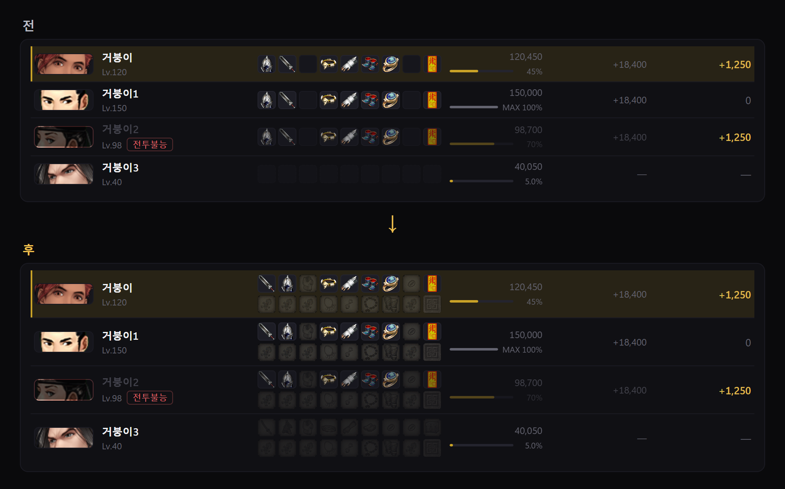

장비 칸은 게임 장비창처럼 두 줄로 늘 같은 자리에 섭니다. 위 줄은 무기 · 관 · 갑옷 같은 부위 9칸,
아래 줄은 외형 · 목걸이 · 귀걸이 · 팔찌 · 각반 · 전용 장비 같은 추가 칸 9칸이고, 빈 칸에는 실루엣이 깔립니다.

### 전투 외 경험치

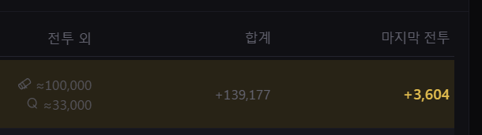

두루마리를 먹거나 퀘스트 경험치를 받으면 부대원 표에 **전투 외** 칸이 생기고, 두루마리와 퀘스트가
아이콘과 함께 한 줄씩 보입니다. 위의 **총 증가 경험치**에는 더하고 아랫줄에 「+10억 전투 외」처럼 따로
알려 주며, **시간당 속도·마지막 전투**에는 넣지 않아 사냥 속도가 튀지 않습니다. 받은 직후 누적 경험치
앞의 `≈` 는 추정이라는 뜻이고, 다음 전투가 끝나면 게임의 값으로 맞춰집니다.

### 정령 친밀도 (실험 기능)

EXP 탭 부대 위에 메인·보조 정령 카드가 생깁니다. 친밀도, 다음 단계까지의 막대, 한 판에 오르는 양(+2,
다정다감 +3, 상급 다정다감 +5)과 남은 판 수를 보여 줍니다. 정령교감시약을 먹으면 고른 정령의 친밀도에 바로
더해지고, 승급하면 새 정령으로 바뀌어 0부터 다시 셉니다.

- 진화할 수 있으면 카드에 마우스를 올려 진화 재료를 볼 수 있습니다. 보관 중인 정령은 **보관** 단추로 펼칩니다.
- 친밀도는 판마다 더해 가는 추정값이라 옆에 **추정**이 붙습니다. 누르면 무엇이 얼마나 더해졌는지 보이고,
  재접속하면 게임의 값으로 맞춰집니다.

기본은 꺼져 있습니다 — 설정 → **정령 친밀도**에서 켜고, 캐릭터를 재접속하면 시작됩니다.

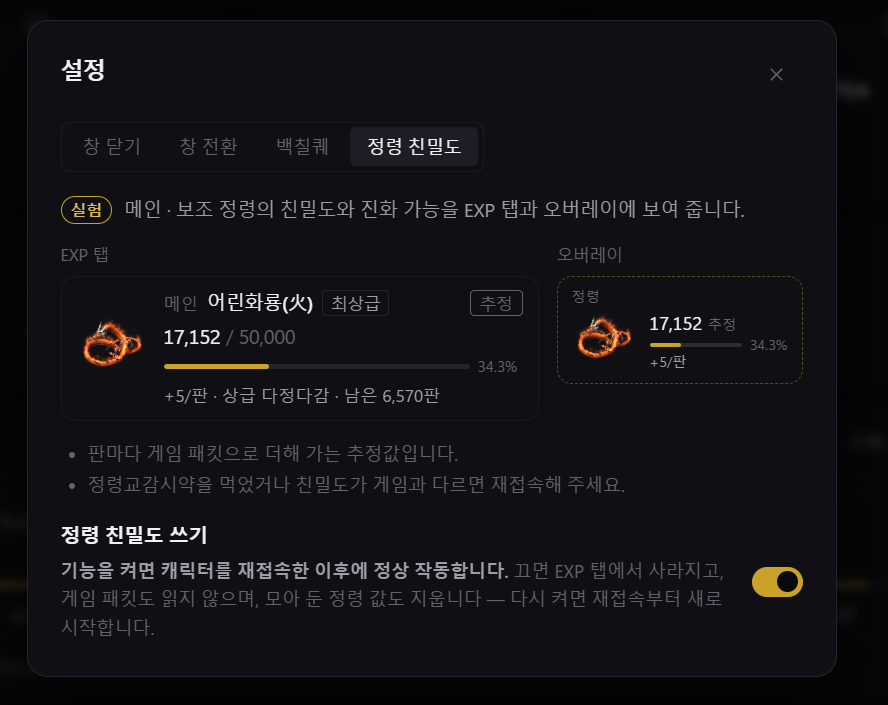

### 신용도 (실험 기능)

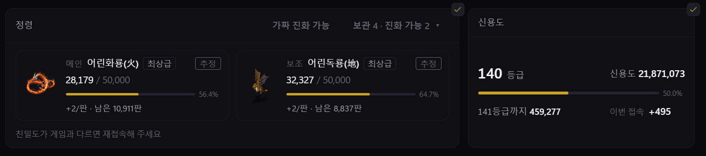

EXP 탭 정령 카드 옆(창이 좁으면 아래)에 신용등급, 신용도, 다음 등급까지의 막대와 남은 신용도,
이번 접속에 오른 만큼을 보여 줍니다. 퀘스트 보상, 막대사탕처럼 신용도를 올리는 아이템, 과거시험으로
오른 만큼을 더해 가고, 상점에서 사고팔 때마다 게임 값으로 맞춰집니다. 기본은 꺼져 있습니다 —
설정 → **신용도**에서 켭니다.

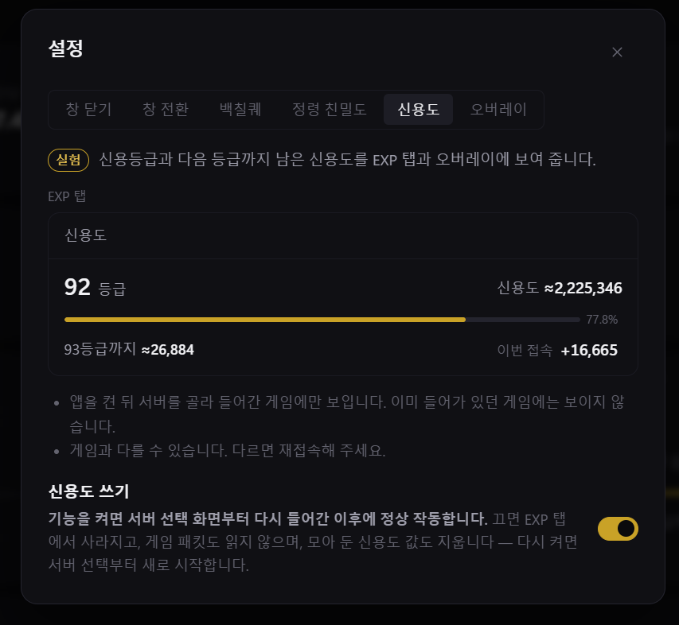

---

## 주막

탭 안에 「임무」와 「용병주막」 두 칸이 있습니다.

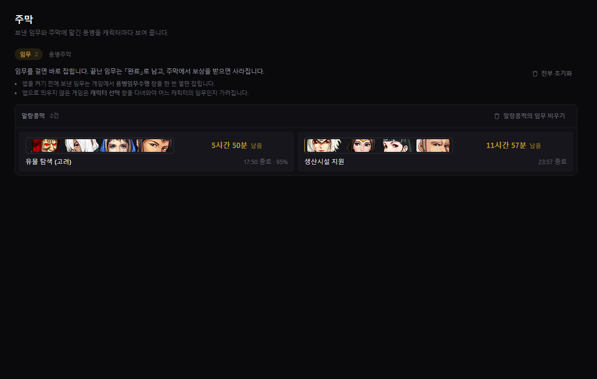

**임무** — 주막에 보낸 용병 임무의 남은 시간을 봅니다. 8시간에서 60시간짜리라 앱을 껐다 켜도
이어집니다. 임무를 걸고 게임의 `용병임무수행` 창을 한 번 열면 잡히고, 끝난 임무는 `완료` 로 남습니다.
주막에서 **보상을 받으면 목록에서 사라지니**, `완료` 로 남은 줄은 "아직 보상을 안 받았다" 는 뜻입니다.
설정 → 「알림」에서 켜 두면 임무가 끝나는 시각에 알려 드립니다.

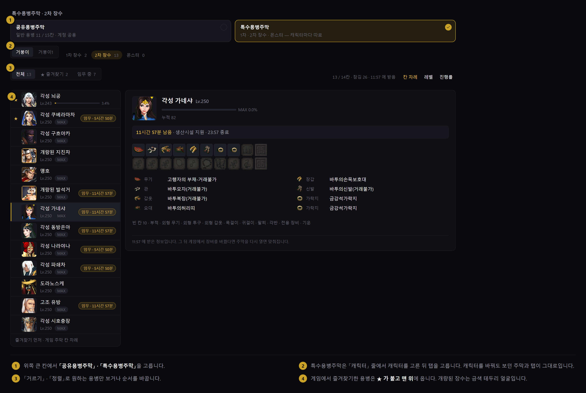

**용병주막** — 게임의 공유용병주막(일반 용병)과 특수용병주막(장수 · 몬스터)에 맡긴 용병을 게임과 같은 칸
차례로 봅니다. 위쪽에서 주막을 고르고, 특수용병주막은 캐릭터와 탭을 고릅니다. 「거르기」로 즐겨찾기 ·
임무 중만, 「정렬」로 게임 순서 · 레벨 순으로 봅니다. 게임에서 즐겨찾기한 용병은 ★ 가 붙고 맨 위에 옵니다.
게임에서 주막을 한 번 열면 채워지고, 따로 저장하지 않습니다.

---

## 거상 이벤트

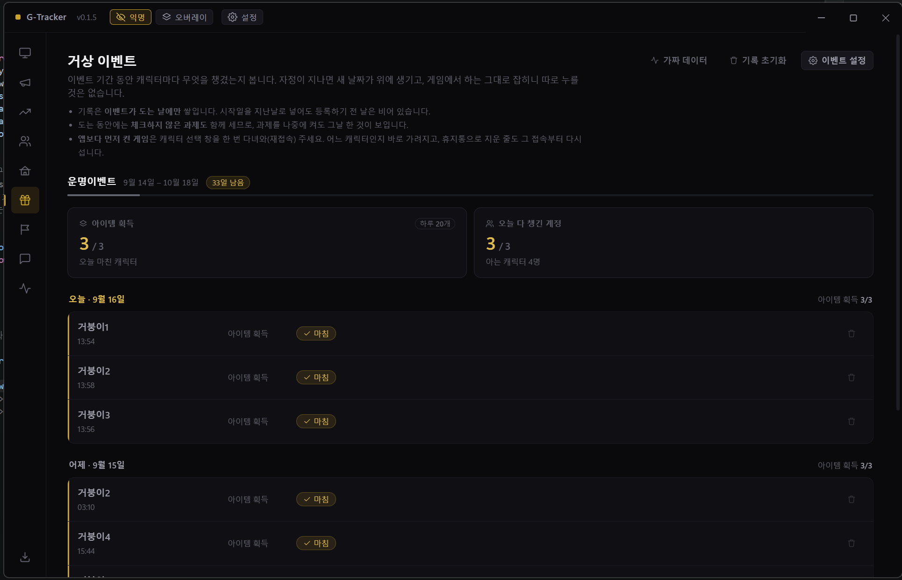

이벤트가 도는 날, **캐릭터마다 그날 과제를 챙겼는지** 봅니다. 날짜별로 묶어 두어 "오늘
아직 안 한 캐릭터" 가 바로 보입니다. 다 챙긴 줄은 `마침` 으로 표시되고, 진행 중인 이벤트가 둘 이상이면
위쪽 이벤트 카드에 다 챙긴 계정 수가 나옵니다.

체크하지 않은 과제도 앱을 끌 때 저장되니, 며칠에 걸친 이벤트도 이어서 챙길 수 있습니다.
이벤트가 없는 날에는 세지 않습니다.

이벤트 기간, 「하루 / 기간」, 그날 챙길 과제(퀘스트·추천 장부·정령 탐색·정령 포획)는 설정 창에서 고릅니다:

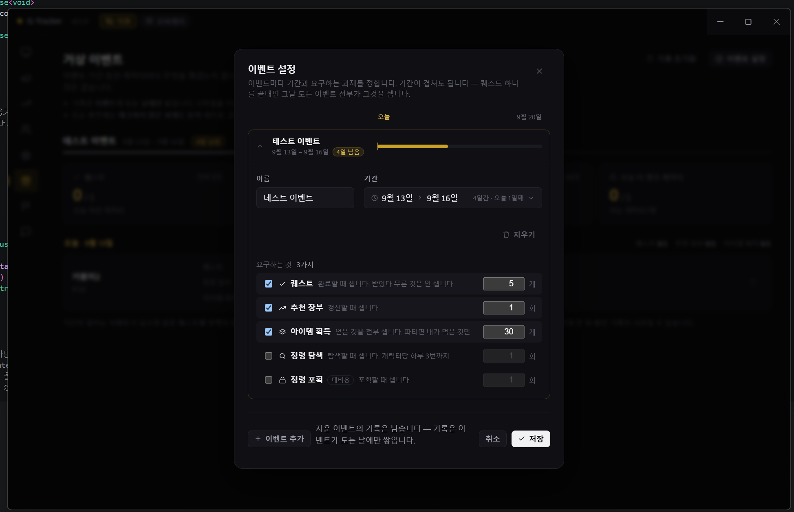

---

## 상단

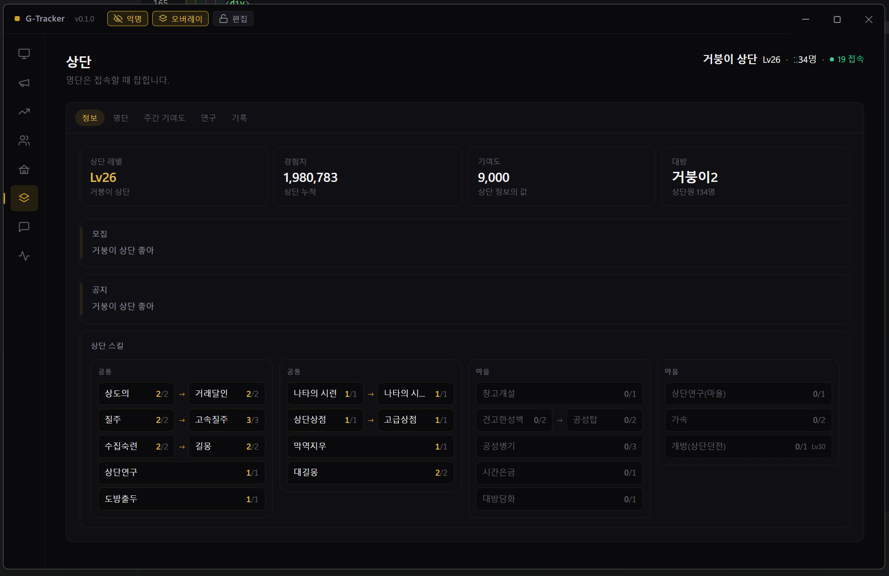

상단(길드) 정보를 게임이 안 남겨 주는 것까지 모아 봅니다. 명단(주간 · 누적 기여도)·연구 지원·기록으로
나뉩니다. 앱을 켜 둔 동안만 모으고, 상단원 이름이 파일에 쌓이지 않게 저장하지 않습니다. 「연구 지원」은 게임에서 연구 지원 현황을 열면 지원한 사람과 아직 지원하지 않은 사람을 나란히
보여 줍니다.

> **명단은 로그인할 때 한 번 들어옵니다.** 그래서 앱을 게임보다 늦게 켜면 명단이 비어
> 있을 수 있습니다. 그럴 때는 앱을 켜 둔 채로 로그인을 한 번 더 하면 채워집니다.

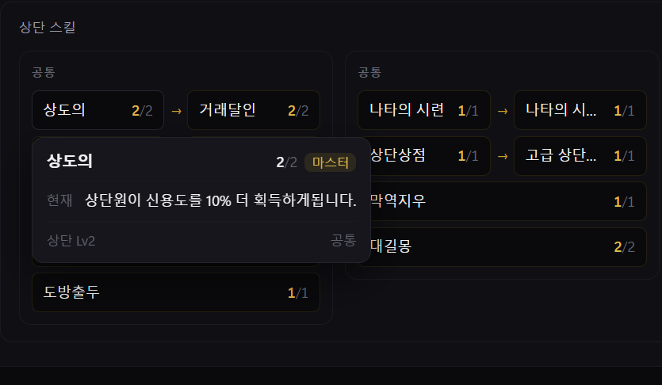

**상단 스킬**에 마우스를 올리면 게임 속 설명과 단계별 효과가 보입니다.

---

## 상자 열기 · 문의

**상자 열기** — 게임이 공개한 확률표로 이벤트 상자를 가상으로 열어 봅니다. 1 · 10 · 100 · 1,000회나
원하는 횟수만큼 열 수 있습니다. 재미로 해 보는 가상 뽑기라 실제 게임 · 수익 · 이벤트 기록과는 무관하고,
기록은 이 PC 에만 남습니다.

**문의** — 개발자에게 바로 글을 보냅니다. 「보내기」를 눌렀을 때만 가고, 로그는 직접 켰을 때만 함께 갑니다.
기능 요청도 여기로 받습니다.

---

## 오버레이

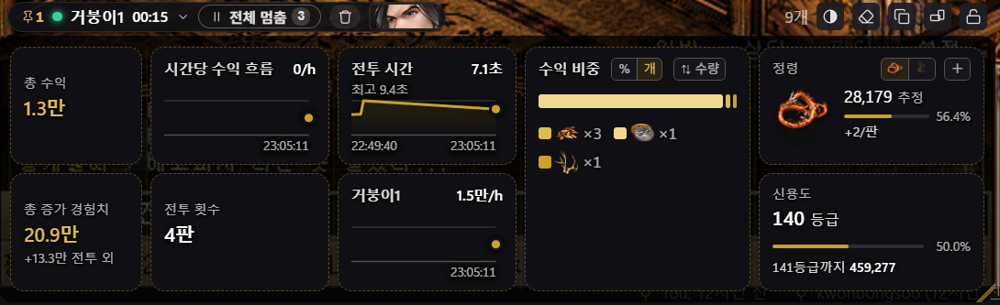

게임 위에 반투명하게 얹는 작은 창입니다. 사냥하는 동안 앱으로 창을 바꾸지 않고도 수익·경험치·정령·신용도
같은 값을 바로 봅니다. 투명도와 크기를 조절할 수 있고, 보고 싶은 것만 골라 띄웁니다 — 앱 화면의 칸마다
모서리에 있는 손잡이로 끌어다 놓습니다. 제목 줄 「오버레이」 옆 숫자 단추(▾)나 설정 → 「오버레이」에서
오버레이 목록 · 새 오버레이 · 글자 크기를 바꿉니다.

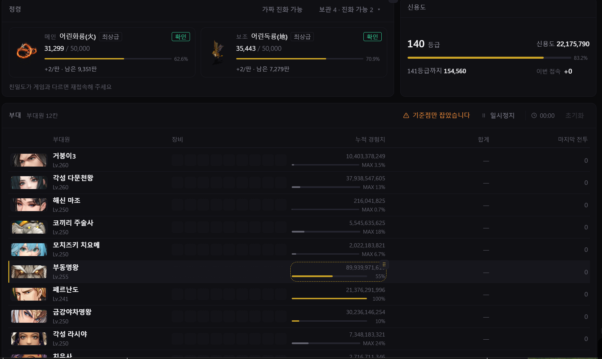

**용병 칸** — 「용병 시간당 흐름」 칸과, EXP 탭 부대원 줄의 「누적 경험치」 손잡이를 끌어 놓아 세우는
「누적 경험치」 칸이 있습니다. 오버레이 잠금을 풀면 칸 머리 오른쪽의 **＋** 로 칸을 넷까지 늘릴 수 있고,
칸마다 볼 용병은 알약의 용병 얼굴을 눌러 고릅니다.

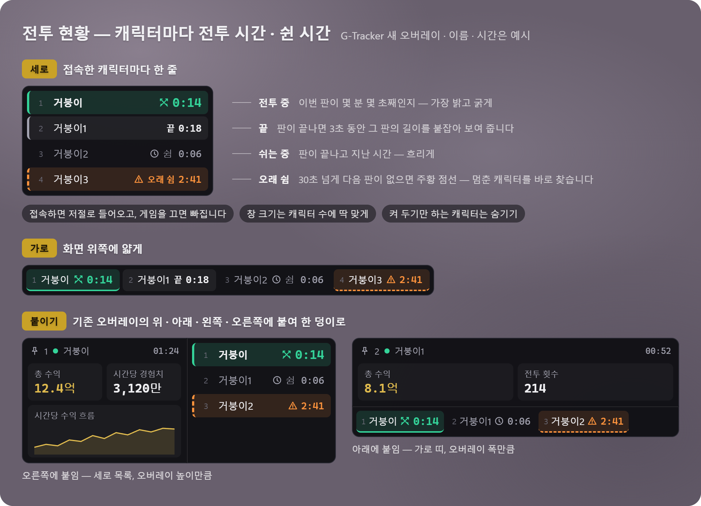

**전투 현황** — 접속한 캐릭터마다 한 줄씩, 전투 중이면 그 판이 몇 초째인지, 쉬고 있으면 쉰 시간을 보여
줍니다. 판이 끝나고 오래(20초 ~ 2분, 고를 수 있음) 다음 판이 없으면 그 줄이 주황 점선으로 바뀌어, 여러
클라로 사냥할 때 멈춘 캐릭터를 바로 찾을 수 있습니다. 따로 띄워도 되고 오버레이 가장자리에 붙여 한 덩이로
쓸 수도 있습니다.

---

## 설정

제목 줄 오른쪽의 **⚙** 를 누르면 열립니다.

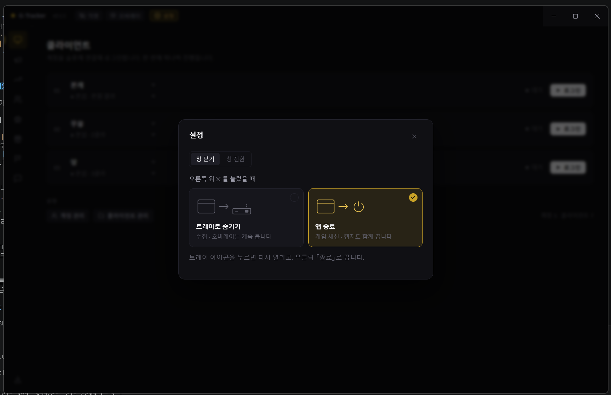

**창 닫기** — 오른쪽 위 **✕** 를 눌렀을 때 무엇을 할지 고릅니다. 기본은 **앱 종료**이고, 게임 세션과
캡처도 함께 꺼집니다. **트레이로 숨기기**를 고르면 창만 사라지고 수집과 오버레이는 계속 돕니다.
숨긴 뒤에는 알림 영역의 트레이 아이콘을 누르면 다시 열리고, 우클릭 「종료」로 끕니다.

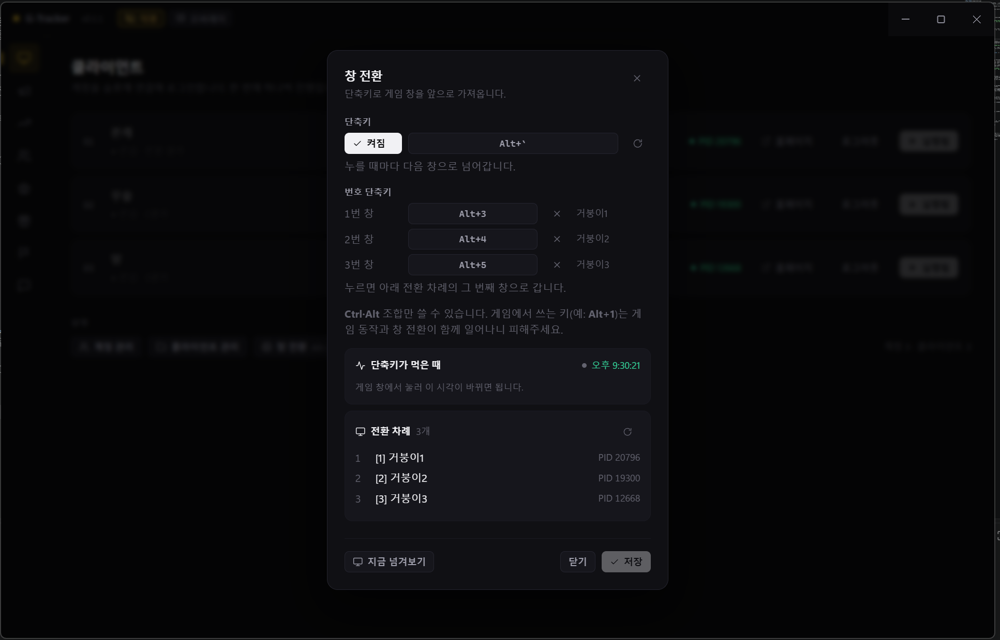

**창 전환** — 단축키로 게임 창을 앞으로 가져옵니다. 누를 때마다 다음 창으로 넘어가는 키와,
1·2·3번 창으로 곧장 가는 번호 키를 따로 둘 수 있습니다. **Ctrl·Alt 조합만** 쓸 수 있으며, 게임에서
쓰는 키(예: Alt+1)는 게임 동작과 창 전환이 함께 일어나니 피해주세요. 아래 「지금 넘겨보기」로 바로
시험해 볼 수 있고, 「전환 차례」에 지금 떠 있는 게임이 순서대로 보입니다.

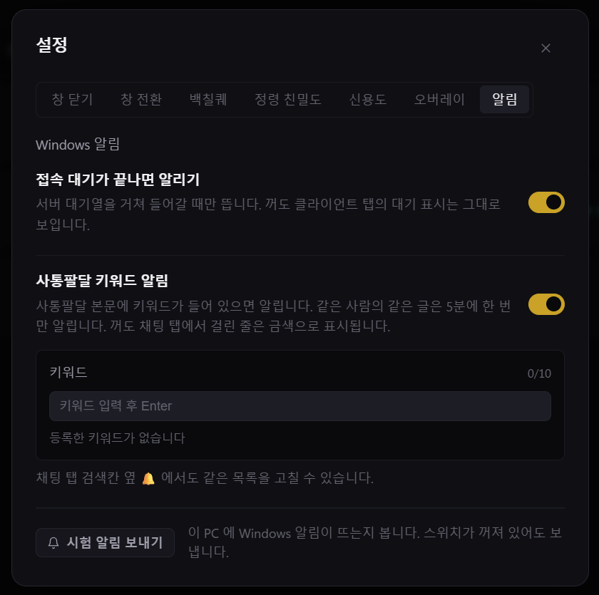

**알림** — 접속 대기 끝 · 사통팔달 키워드 · 주막 임무 끝 알림을 켜고 끄고, 받을 곳을 고릅니다
(Windows 알림 · 디스코드 · 받지 않음). 「시험 알림 보내기」로 알림이 오는지 볼 수 있습니다.

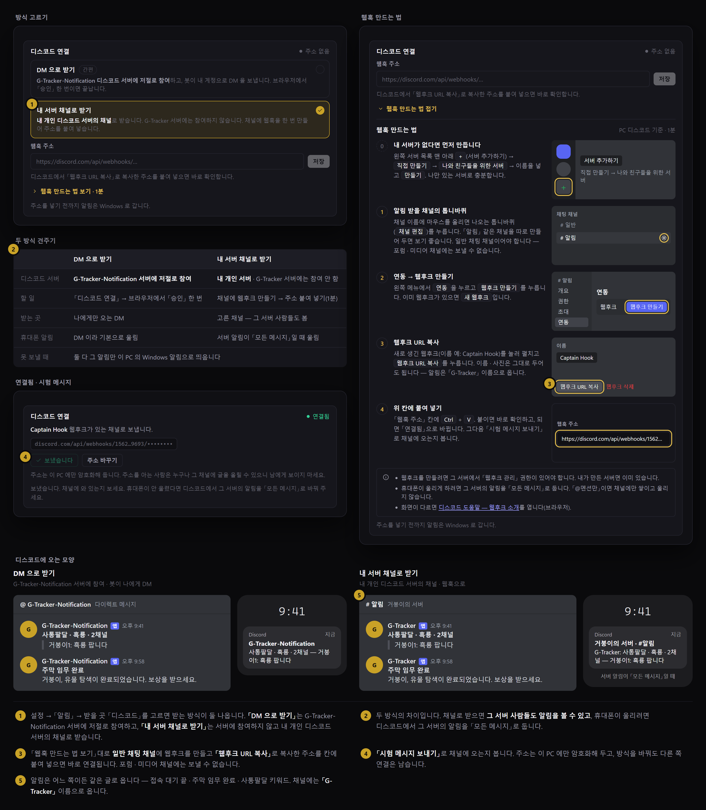

디스코드를 고르면 두 방식이 있습니다.

- **DM 으로 받기** — 「디스코드 연결」에서 승인을 한 번 누르면 G-Tracker-Notification 서버에 들어가고,
  봇이 내 계정으로 DM 을 보냅니다. 그 서버를 나가면 DM 이 막혀 이 PC 의 Windows 알림으로 돌아갑니다.
- **내 서버 채널로 받기** — G-Tracker 서버에 들어가지 않고, 내 디스코드 서버 채널에 만든 웹후크 주소를
  붙여 넣어 받습니다. 그 채널을 볼 수 있는 사람은 알림도 보니, 혼자 보려면 나만 있는 서버를 쓰세요.
  웹후크 주소는 이 PC 에만 암호화해 두니 남에게 보이지 마세요.

보내는 것은 슬롯 번호와 알림 글뿐입니다. 로그인 아이디는 보내지 않고, 익명 모드면 캐릭터 이름도 뺍니다.

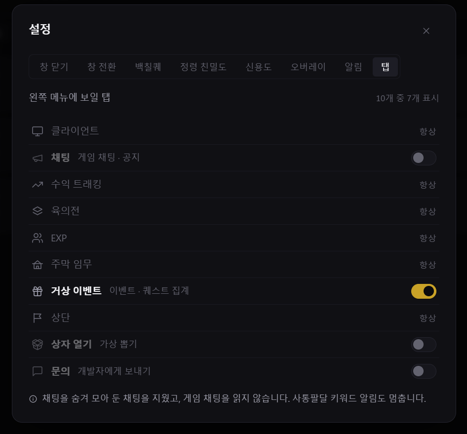

**탭** — 안 쓰는 탭을 왼쪽 메뉴에서 숨깁니다. 숨긴 탭에 쓰던 게임 패킷은 읽지 않습니다. 채팅을 숨기면
모아 둔 채팅을 지우고 사통팔달 알림도 멈춥니다.

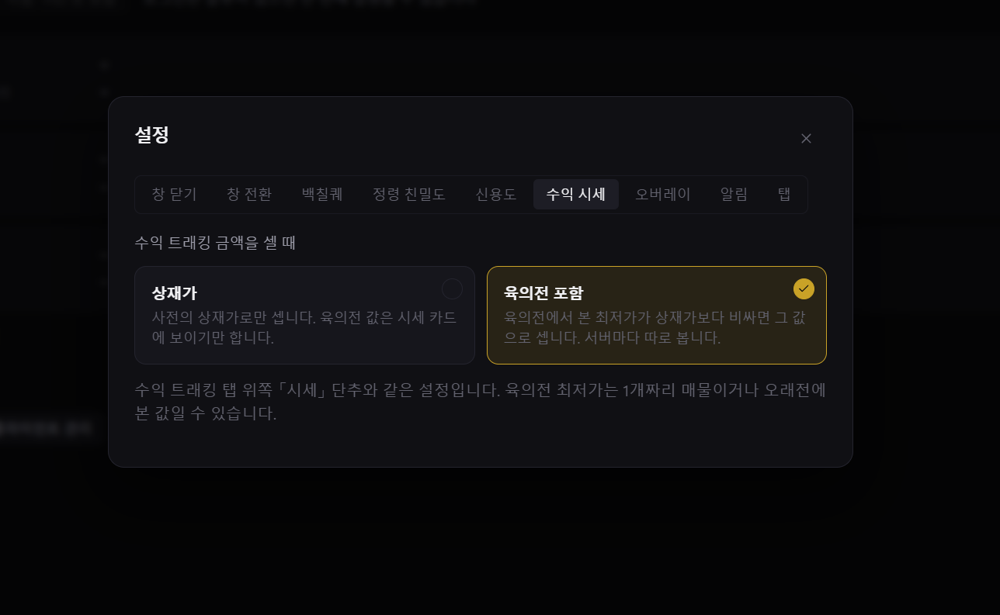

**수익 시세** — 수익 트래킹 · 가방이 쓰는 시세 기준을 바꾸고, 아이템마다 따로 고른 수를 봅니다.
